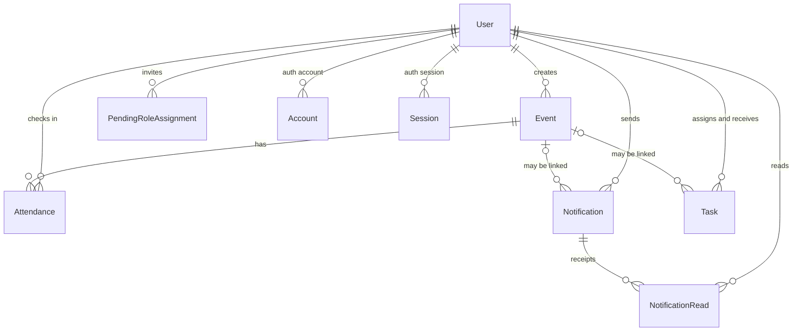

# Data Model

## Overview

The application uses PostgreSQL through Prisma. The schema and migrations live in `prisma/`, and IDs are generated by
Prisma.

Some rules are enforced by the database: unique emails, foreign keys, one read receipt per user per notification, a
global partial unique index on the President's officer position, and a `CHECK` constraint that only an officer can hold a
presidential position. Other rules are enforced by the application: external-email approval, exactly-one-President
replacement, and (in later phases) registration and scan-day invariants.

## Main relationships

The club relations are legacy, read-only database columns kept until the approved cleanup migration. New records write
no club reference, and no active code path reads one.

## Main records

### Users and invitations

A user is the local account created on first successful sign-in. It stores the email identity, display details, role,
optional global officer position, active status, and whether an external address was approved.

Users are not deleted by the application. Deactivation is the supported way to revoke access, and it keeps the person's
history and references intact. Deactivating a President clears the officer position.

A pending invitation stores the intended role, optional officer position, external-email decision, and who created it. It
exists before the account does and is consumed only when a new user is created. Consuming a presidential invitation
replaces the sitting President in the same transaction.

### Legacy club columns

The `Club` table and the `clubId` columns on users, events, tasks, invitations, and notifications are retained as
read-only legacy columns. ADR-0009 records the single-organization model and the separately-approved cleanup migration
that must physically remove them. No active code path reads or writes them.

### Events and attendance

An event describes something happening at a place and time. It has a title, optional description, venue, start and
optional end time, and the user who created it. In the active UI the organizer is shown as KASAMA or the creator name;
there is no club host.

Attendance records a check-in: the event, the user, a check-in time, the entry method (`QR` or `MANUAL`), and the
recording officer. The legacy photo reference column remains required but is written empty for new check-ins. It is not
a registration or RSVP; a check-in requires an active registration for the same event. The `(eventId, studentId)` unique
constraint is the duplicate boundary, so two concurrent scans produce one row and one `already attended` result.

### Notifications and reads

A notification stores its title, body, audience, author, creation time, legacy club column, and optional event link. New
notifications always write `audience: ALL, clubId: null`; legacy club-scoped rows remain stored but are hidden from every
feed. The application no longer sends notification email this round; the shared mail helper survives for invitation
email and future event email.

A read receipt links one notification to one user. Marking a notification read is an upsert, so repeated opens do not
create duplicates.

### Authentication tables

The Auth.js adapter tables link local users to Google accounts and support the standard authentication flow. The
application uses session tokens rather than database session rows for authorization, but the adapter schema remains
intact.

## Rules and constraints

- Email addresses are unique, and the application normalises them to lowercase before storing or looking them up.
- Pending invitation emails are unique, so inviting the same address again updates the existing record.
- Exactly one active officer may hold the `PRESIDENT` position. The database enforces it with a partial unique index plus
  a `CHECK` constraint, and the application replaces one President with another in a single transaction.
- A user can have at most one attendance record per event.
- A user can have at most one read receipt per notification.
- Deleting an event clears the event link on related notifications.
- Records that reference a user or notification keep that reference protected by a foreign key.

## Record lifecycles

**Invitation.** An admin creates a pending record. On the person's first sign-in, the account is created from that
record and the pending record is removed. Re-inviting an existing user does not update the existing account.

**Access removal.** An account is deactivated rather than deleted. It can no longer sign in or use existing sessions,
and reactivation restores the same role. Deactivating a President clears the officer position; the People page then shows
the "No President appointed" state until another one is appointed.

**Read state.** Opening a notification creates or updates the user's read receipt. The feed uses those receipts to show
read and unread items.

## Event attendance workflow

The `Event`, `Registration`, `Attendance`, and `Task` models back the event lifecycle, registration, and officer
attendance workflow. `Registration` is the source of truth for "who said they were coming?" and owns the opaque
`KASAMA-…` reference encoded in the ticket QR. `Attendance` answers "who checked in?" and is only written after the
server resolves an active registration for the selected published event. Officer attendance pages read persisted rows
only; see [ARCHITECTURE.md](./ARCHITECTURE.md) for the page and action boundaries.

## What is not modelled

There is no separate club membership table; the legacy user club column was that membership model, and the active code
path no longer reads it. There is no registration or RSVP record in the schema yet, no soft-delete flag, no audit log, and
no change history. Event, registration, and scan actions follow later phases.

Dates are stored as timestamps and displayed in the configured application timezone, so server and browser rendering
agree.
